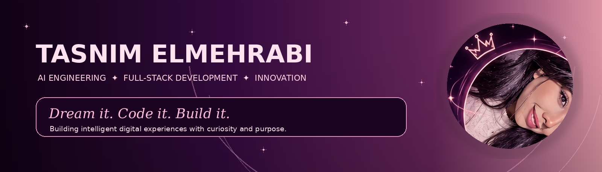
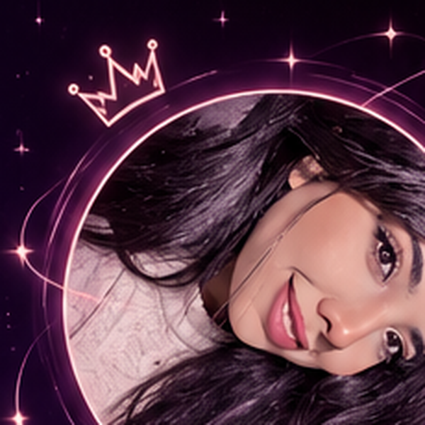

 

  

*“Dream it. Code it. Build it.”* ♡

---

<table>
<tr>
<td width="68%" valign="middle">

## ✦ A little about me

Hi! I'm **Tasnim El Mehrabi**, a Computer Science graduate in **Software Engineering and Information Systems**, interested in the intersection of software engineering and artificial intelligence.

I love taking an idea from its first sketch to a working application — learning, experimenting and collaborating along the way.

- ✧ AI engineering, machine learning and local LLMs
- ✧ Full-stack and mobile application development
- ✧ Big Data and intelligent solutions
- ✧ Product thinking, teamwork and leadership
- ✧ Always curious. Always building.

> **My mindset:** Build with purpose. Learn continuously. Create impact.

</td>
<td width="32%" align="center" valign="middle">

**TASNIM ELMEHRABI**

Software Engineering · AI · Full Stack

Dream it · Code it · Build it ♡

</td>
</tr>
</table>

## ✧ My Tech Universe

<table>
<tr>
<td align="center" width="50%">

**⌘ Languages**

</td>
<td align="center" width="50%">

**✦ Frontend · Backend · Mobile**

</td>
</tr>
<tr>
<td align="center">

**◈ Data · Tools · Platforms**

</td>
<td align="center">

**✧ AI · Big Data**

</td>
</tr>
</table>

---

## ✦ Selected Projects

<table>
<tr>
<td width="33%" valign="top">

### 🖱️ AI Virtual Mouse

Hand-gesture-powered mouse interaction, bringing computer vision into everyday desktop control.

<a href="https://github.com/tass027/ai-virtual-mouse">View repository ↗</a>

</td>
<td width="33%" valign="top">

### 🐝 Study with Bee

An Android study companion combining productivity tools, study routines and AI-assisted learning features.

<a href="https://github.com/tass027/study-with-bee">View repository ↗</a>

</td>
<td width="33%" valign="top">

### ✦ Planify.tn

A platform for personalized outing and gift recommendations.

<a href="https://github.com/tass027/planify-tn">View repository ↗</a>

</td>
</tr>
<tr>
<td width="33%" valign="top">

### 🎙️ Speech-to-Text AI

AI-powered audio transcription and text processing, including summarization and translation workflows.

<a href="https://github.com/tass027/speech-to-text-ai">View repository ↗</a>

</td>
<td width="33%" valign="top">

### 📄 AI Resume Builder

An AI-assisted project focused on CV creation and optimization.

<a href="https://github.com/tass027/ai-resume-builder">View repository ↗</a>

</td>
<td width="33%" valign="top">

### 🚀 MEDIANET Incubator

A startup management and follow-up platform with intelligent scoring, matching, reporting and chatbot features.

<a href="https://github.com/tass027/medianet-incubator">View repository ↗</a>

</td>
</tr>
</table>

## ✧ GitHub Analytics

 

## ✦ Contribution Garden

Every contribution is a little step forward ✦

---

<table>
<tr>
<td width="55%" valign="middle">

## ✧ Beyond the Code

**Leadership · Creativity · Collaboration · Continuous Learning**

Former Vice President of Human Resources at **Enactus ISI**.

I enjoy bringing people together, exchanging ideas and exploring how technology and entrepreneurship can create meaningful impact.

</td>
<td width="45%" align="center" valign="middle">

## ✧ Let's Connect

<!-- Replace the LinkedIn URL below with your personal profile URL. -->

</td>
</tr>
</table>

*Have an interesting idea? Let's build something meaningful.* ♡

Designed with curiosity, creativity and a little bit of magic · © Tasnim El Mehrabi

