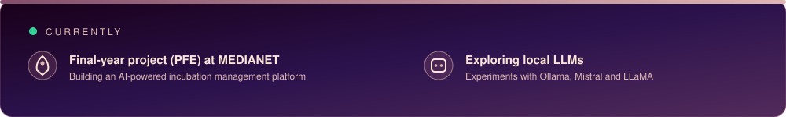
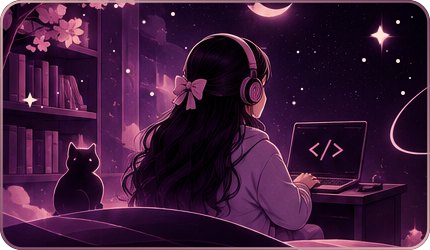
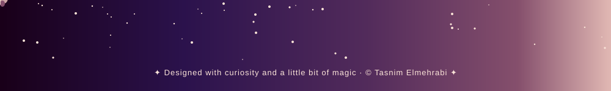

<table>
<tr>
<td width="62%" valign="middle">

<h2>✦ About Me</h2>

Hi! I'm <b>Tasnim Elmehrabi</b>, an <b>AI Engineering student</b> who loves turning curious ideas into useful digital experiences.

I enjoy the space where <b>software engineering, artificial intelligence and creativity</b> meet: from full-stack apps to experiments with local language models, I'm always exploring what's possible.

<ul>
<li>✧ AI engineering, machine learning and local LLMs</li>
<li>✧ Full-stack and mobile application development</li>
<li>✧ Big Data and intelligent solutions</li>
<li>✧ Product thinking, teamwork and leadership</li>
<li>✧ Learning by building, one project at a time</li>
</ul>

🌙 <b>Current mindset:</b> <i>Build with purpose. Learn continuously. Create impact.</i>

</td>
<td width="38%" align="center" valign="middle">

<b>TASNIM ELMEHRABI</b> 
AI Engineer in progress ✦ 
Dream it · Code it · Build it

</td>
</tr>
</table>

## ✦ Selected Projects

## ✧ Tech Stack

<table>
<tr>
<td align="center" width="50%">

<b>⌘ Languages</b>  

</td>
<td align="center" width="50%">

<b>✦ Frontend · Backend · Mobile</b>  

</td>
</tr>
<tr>
<td align="center">

<b>◈ Data · Tools · Platforms</b>  

</td>
<td align="center">

<b>✧ AI · Big Data</b>  

</td>
</tr>
</table>

## ✦ My Little Universe

🌙 Night owl · ☕ Coffee in a GitHub mug · 🐈 Cats approved ✦

## ✦ Beyond the Code

<b>Leadership · Creativity · Collaboration · Continuous Learning</b>

Vice President of Human Resources at <b>Enactus ISI</b> 💜

<i>I enjoy bringing people together, exchanging ideas and exploring how technology and entrepreneurship can create meaningful impact.</i>

## ✧ Let's Connect

<!-- TO COMPLETE: replace VOTRE-PROFIL with your real LinkedIn username -->

 

<i>Have an interesting idea? Let's build something meaningful.</i> ♡

