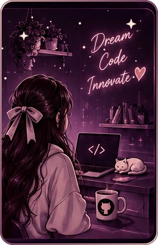

 

  

  <table> <tr> <td width="62%" valign="middle">
✦ About Me

Hi! I'm Tasnim Elmehrabi, an AI Engineering student who loves turning curious ideas into useful digital experiences.

I enjoy the space where software engineering, artificial intelligence and creativity meet: from full-stack apps to experiments with local language models, I'm always exploring what's possible.

✧ AI engineering, machine learning & local LLMs
✧ Full-stack and mobile application development
✧ Big Data and intelligent solutions
✧ Product thinking, teamwork & leadership
✧ Learning by building, one project at a time

🌙 Current mindset: Build with purpose. Learn continuously. Create impact.

</td> <td width="38%" align="center" valign="middle"> 

TASNIM ELMEHRABI AI Engineer in progress ✦ Dream it · Code it · Build it

</td> </tr> </table> 
  
 
✦ My Little Universe

   

🌙 Night owl · ☕ Coffee in a GitHub mug · 🐈 Cats approved ✦

 
✧ Tech Stack

 <table> <tr> <td align="center" width="50%">

⌘ Languages

 </td> <td align="center" width="50%">

✦ Frontend · Backend · Mobile

 </td> </tr> <tr> <td align="center">

◈ Data · Tools · Platforms

 </td> <td align="center">

✧ AI · Big Data

    </td> </tr> </table> 
 
✦ Selected Projects

     

 
✧ GitHub Constellation

    

🐍 Every contribution is a little step forward ✦

 
✦ Beyond the Code

Leadership · Creativity · Collaboration · Continuous Learning

Vice President of Human Resources at Enactus ISI 💜

I enjoy bringing people together, exchanging ideas and exploring how technology and entrepreneurship can create meaningful impact.

✧ Let's Connect

 

 

Have an interesting idea? Let's build something meaningful. ♡

 
